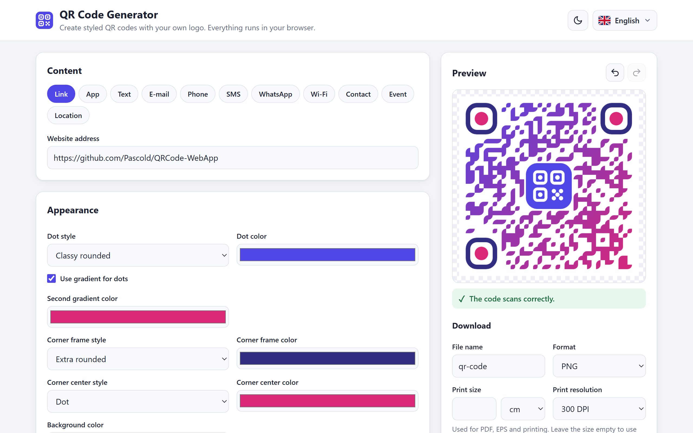

<div align="center">

# QR Code Generator

**Styled QR codes with your own logo that never expire.**<br>
No sign-up, no tracking, no redirects: everything runs in your browser.

[](https://pascold.github.io/QRCode-WebApp/)
[](https://github.com/Pascold/QRCode-WebApp/actions/workflows/pages.yml)
[](LICENSE)
[](#requirements)
[](#languages)
[](#privacy)
[](#offline-mode)

**[Open the app →](https://pascold.github.io/QRCode-WebApp/)**

<picture>
  <source media="(prefers-color-scheme: dark)" srcset=".github/assets/screenshot-dark.png">
  
</picture>

</div>

## Why another QR generator?

Search for "free QR code generator" and most of the top results give you a **dynamic** code. The QR code holds a short link to *their* server, which redirects to your address. That lets them count your scans, and it lets them **switch the code off** when the free trial ends or unless you pay for a subscription. Printed flyers, menus and business cards then lead to a paywall or an error page.

This project does the opposite:

- **The code contains your content directly** (your link, Wi-Fi password, contact card, etc.). It works for as long as that content does, with no account and no third-party server in between.
- **Nothing leaves your device.** The QR code, your logo and your settings are processed in the browser. There are no analytics, no cookies for tracking, no CDNs and no third-party requests. You can check: the Content Security Policy only allows the page's own files.
- **Print-ready output.** You get vector SVG and print-size PDF / EPS at up to 600 DPI, not only a small PNG.
- **It checks that the code scans.** After every change the code is decoded in the browser, as a phone camera would, so a logo that is too big or colors that are too light are flagged before you print.
- **Easy to self-host.** It is plain PHP with no database, Composer or build step, or a static site (one page per language) on GitHub Pages or any static host. Everything is MIT-licensed.

## Features

- Generate QR codes for **links, App Store / Google Play apps, plain text, e-mail, phone numbers, SMS, WhatsApp, Wi-Fi networks, contact cards (vCard or the shorter MeCard), calendar events and map locations**. Any language and emoji are encoded as UTF-8.
- Customize the look: **dot style** (square, dots, rounded, extra rounded, classy, classy rounded), **corner styles**, colors, optional **gradient**, transparent background, size, margin and error correction level.
- Place your own **image / logo in the center** of the code - choose a file, **drag it onto the card** or **paste it with Ctrl+V** (e.g. a screenshot).
- Live preview and export to **PNG, SVG, PDF, JPG, WebP, AVIF, GIF, BMP and EPS**, plus **Print**, **Share** (phones), **Copy image** and **Copy SVG code**.
- **Print size** in mm, cm or inches at 150, 300 or 600 DPI for PDF, EPS and printing.
- **Undo / redo** with buttons or Ctrl+Z / Ctrl+Y (Ctrl+Shift+Z).
- **Works offline** after the first visit (service worker).
- **92 languages and regional variants** (BCP 47 locale codes such as `pl`, `en-GB`, `sr-Latn`, `zh-HK`) in a searchable dropdown with flags, including right-to-left support for Arabic, Hebrew, Persian and Urdu. Adding more takes one file.
- **Light and dark theme**, following the operating system by default, with a toggle in the header.
- **Private by design:** content and images are processed entirely in the browser and never uploaded to the server. Your current settings (including the center image) survive a language switch or reload thanks to `sessionStorage` in your own browser tab.
- **Readability check:** after every change the code is decoded in the browser (with jsQR, like a phone camera would) and the preview shows whether it scans correctly.
- **Contrast check:** a warning appears when the dots are too light or lighter than the background (inverted codes), which many phones cannot scan.
- **Saved styles:** save the current look (colors, shapes, size, image) under a name and load it again with one click - stored only in the browser (`localStorage`).
- **Style link:** copy a link that carries the current style (not the content and not the image) after `#` in the address, so you can send your look to someone else.
- **Installable** on phones and desktops (web app manifest and icons).
- Searchable language dropdown with **keyboard navigation** (arrows, Home/End, Enter, Escape).

## Requirements

| Environment | Version |
|-------------|---------|
| PHP         | 8.2 or newer (tested on 8.2, compatible with 8.5) |
| Web server  | Apache (e.g. XAMPP), Nginx + PHP-FPM, or PHP's built-in server |
| Browser     | Any modern browser (Chrome, Edge, Firefox, Safari) |

No database, no Composer, no build step and no PHP extensions beyond the defaults are required.

## Installation

### Local - XAMPP (Windows / macOS / Linux)

1. Copy the project folder into XAMPP's `htdocs` directory, e.g. `C:\xampp\htdocs\QRCode-WebApp`.
2. Start **Apache** in the XAMPP Control Panel.
3. Open <http://localhost/QRCode-WebApp/> in your browser.

The project can live in any sub-folder; all paths are relative.

### Local - PHP built-in server

```bash
php -S localhost:8000
```

Then open <http://localhost:8000>.

### Production server

1. Upload all files to the web root (or a sub-folder) of your server running PHP 8.2+ (e.g. PHP 8.5).
2. **Apache:** the included `.htaccess` files block access to internal folders (`src/`, `lang/`, `templates/`) and `config.php`. Make sure `AllowOverride All` (or at least `FileInfo Indexes Limit`) is enabled.
3. **Nginx:** add an equivalent rule, for example:

   ```nginx
   location ~ ^/(src|lang|templates)/ { deny all; }
   location = /config.php { deny all; }
   location ~ /\. { deny all; }
   ```

4. Serve the site over **HTTPS** - the "Copy image" button relies on the Clipboard API, which browsers only enable in secure contexts (`https://` or `localhost`).

### GitHub Pages (static version)

GitHub Pages cannot run PHP, so the repository includes a build script that renders a static copy of the app - one page per language:

| URL | Content |
|-----|---------|
| `/` | Start page - opens the saved language, or the best match for the browser languages |
| `/pl/`, `/en-GB/`, `/sr-Latn/`, … | The app in that language (92 pages) |
| `/404.html` | Fixes the letter case of language URLs (`/en-gb/` → `/en-GB/`), anything else goes to the start page |

The live version is published automatically by [`.github/workflows/pages.yml`](.github/workflows/pages.yml) on every push to `main`:

1. One-time setup: repository **Settings → Pages → Build and deployment → Source: GitHub Actions**.
2. Push to `main` (or run the workflow manually from the **Actions** tab).
3. The site appears at `https://<user>.github.io/<repository>/` - for this repository <https://pascold.github.io/QRCode-WebApp/>.

The workflow also checks all translations and lints the PHP files before deploying.

To build it locally:

```bash
php tools/build-static.php --out=dist --base=/
```

`--base` is the URL path the site is served from (`/<repository>/` for a GitHub Pages project site, `/` for a custom domain). The `dist/` folder is ignored by Git.

Differences from the PHP version:

| | PHP server | Static (GitHub Pages) |
|---|---|---|
| Language URLs | `?lang=pl` | `/pl/` |
| Preferences (language, theme) | cookies | `localStorage` |
| Browser language detection | `Accept-Language` header | `navigator.languages` on the start page |
| Security headers | HTTP headers | `<meta>` Content-Security-Policy and referrer policy |

The `.htaccess` files stay in the repository for anyone who downloads the project and runs the PHP version on Apache.

## Configuration

All settings live in [`config.php`](config.php):

| Key | Description | Default |
|-----|-------------|---------|
| `default_language` | Fallback locale code | `en` |
| `language_dir` | Folder with translation files | `lang/` |
| `language_cookie` | Cookie that remembers the chosen language | `qr_lang` |
| `language_cookie_lifetime` | Cookie lifetime in seconds | 1 year |
| `theme_cookie` | Cookie that remembers the light/dark theme | `qr_theme` |
| `site_url` | Public address of the site (ending with `/`), used for the link preview image (Open Graph / Twitter Card). Empty = no preview image | GitHub Pages URL |
| `author_name`, `author_url` | Author credited in the footer | `Pascold` |
| `repository_url`, `license_url` | Footer links to the source code and license | GitHub repository |
| `max_logo_size_mb` | Maximum center image size | `5` |

## Languages

Each language is one file in `lang/`, named after its [BCP 47](https://www.rfc-editor.org/info/bcp47) locale code: `language[-Script][-REGION]`, e.g. `pl.php`, `en-GB.php`, `sr-Latn.php`, `zh-HK.php`. Codes are matched case-insensitively, so `?lang=en-gb` works too.

The language is chosen in this order:

1. `?lang=<code>` in the URL (the choice is saved in a cookie),
2. the saved cookie,
3. the browser's `Accept-Language` header - each tag is tried from most to least specific (`sr-Latn-RS` → `sr-Latn` → `sr`), and *aliases* map codes without their own file (e.g. `no` → `nb`, `zh-Hant` → `zh-TW`, `es-419` → `es-MX`),
4. `default_language` from `config.php`.

### Regional variants

A regional variant can inherit from another locale with `'parent'` and list only the strings that differ. Lookup order is: the locale itself → its parent chain → `default_language`.

| Variant | Parent | Differences |
|---------|--------|-------------|
| `en-US` | `en` | none |
| `en-GB`, `en-CA`, `en-AU` | `en` / `en-GB` | British spelling (colour, centre) |
| `de-AT` | `de` | none |
| `de-CH` | `de` | "ss" instead of "ß", Swiss quotation marks |
| `fr-CA` | `fr` | "courriel" |
| `es-MX` | `es` | Latin American wording |
| `es-AR` | `es-MX` | voseo ("Ingresá", "Elegí") |
| `nl-BE` | `nl` | none |
| `zh-HK` | `zh-TW` | Hong Kong terms (網絡, 短訊) |

`sr-Cyrl` and `sr-Latn` are complete translations (one is a transliteration of the other).

### Included languages

| Code | Language | Native name | Flag | Notes |
|------|----------|-------------|------|-------|
| `af` | Afrikaans | Afrikaans | za |  |
| `sq` | Albanian | Shqip | al |  |
| `am` | Amharic | አማርኛ | et |  |
| `ar` | Arabic | العربية | arab | RTL |
| `hy` | Armenian | Հայերեն | am |  |
| `az` | Azerbaijani | Azərbaycan dili | az |  |
| `eu` | Basque | Euskara | es-pv |  |
| `be` | Belarusian | Беларуская | by |  |
| `bn` | Bengali | বাংলা | bd |  |
| `bs` | Bosnian | Bosanski | ba |  |
| `bg` | Bulgarian | Български | bg |  |
| `my` | Burmese | မြန်မာ | mm |  |
| `ca` | Catalan | Català | es-ct |  |
| `zh-CN` | Chinese (Simplified) | 简体中文 | cn | aliases: `zh`, `zh-hans`, `zh-hans-cn`, `zh-sg`, `zh-hans-sg` |
| `zh-HK` | Chinese (Traditional, Hong Kong) | 繁體中文（香港） | hk | inherits `zh-TW`; aliases: `zh-hant-hk`, `zh-mo`, `zh-hant-mo` |
| `zh-TW` | Chinese (Traditional, Taiwan) | 繁體中文（台灣） | tw | aliases: `zh-hant`, `zh-hant-tw` |
| `hr` | Croatian | Hrvatski | hr |  |
| `cs` | Czech | Čeština | cz |  |
| `da` | Danish | Dansk | dk |  |
| `nl` | Dutch | Nederlands | nl |  |
| `nl-BE` | Dutch (Belgium) | Nederlands (België) | be | inherits `nl` |
| `en` | English | English | gb | default |
| `en-AU` | English (Australia) | English (Australia) | au | inherits `en-GB`; aliases: `en-nz` |
| `en-CA` | English (Canada) | English (Canada) | ca | inherits `en-GB` |
| `en-GB` | English (UK) | English (UK) | gb | inherits `en`; aliases: `en-ie` |
| `en-US` | English (US) | English (US) | us | inherits `en` |
| `et` | Estonian | Eesti | ee |  |
| `fil` | Filipino | Filipino | ph | aliases: `tl`, `tl-ph`, `fil-ph` |
| `fi` | Finnish | Suomi | fi |  |
| `fr` | French | Français | fr |  |
| `fr-CA` | French (Canada) | Français (Canada) | ca | inherits `fr` |
| `gl` | Galician | Galego | es-ga |  |
| `ka` | Georgian | ქართული | ge |  |
| `de` | German | Deutsch | de |  |
| `de-AT` | German (Austria) | Deutsch (Österreich) | at | inherits `de` |
| `de-CH` | German (Switzerland) | Deutsch (Schweiz) | ch | inherits `de`; aliases: `de-li` |
| `el` | Greek | Ελληνικά | gr |  |
| `gu` | Gujarati | ગુજરાતી | in |  |
| `ha` | Hausa | Hausa | ng |  |
| `he` | Hebrew | עברית | il | RTL; aliases: `iw`, `iw-il` |
| `hi` | Hindi | हिन्दी | in |  |
| `hu` | Hungarian | Magyar | hu |  |
| `is` | Icelandic | Íslenska | is |  |
| `ig` | Igbo | Igbo | ng |  |
| `id` | Indonesian | Bahasa Indonesia | id | aliases: `in` |
| `ga` | Irish | Gaeilge | ie |  |
| `it` | Italian | Italiano | it |  |
| `ja` | Japanese | 日本語 | jp |  |
| `kn` | Kannada | ಕನ್ನಡ | in |  |
| `kk` | Kazakh | Қазақ тілі | kz |  |
| `km` | Khmer | ខ្មែរ | kh |  |
| `ko` | Korean | 한국어 | kr |  |
| `lo` | Lao | ລາວ | la |  |
| `lv` | Latvian | Latviešu | lv |  |
| `lt` | Lithuanian | Lietuvių | lt |  |
| `lb` | Luxembourgish | Lëtzebuergesch | lu |  |
| `mk` | Macedonian | Македонски | mk |  |
| `ms` | Malay | Bahasa Melayu | my |  |
| `ml` | Malayalam | മലയാളം | in |  |
| `mr` | Marathi | मराठी | in |  |
| `mn` | Mongolian | Монгол | mn |  |
| `ne` | Nepali | नेपाली | np |  |
| `nb` | Norwegian (Bokmål) | Norsk bokmål | no | aliases: `no`, `nn`, `nb-no`, `nn-no` |
| `fa` | Persian | فارسی | ir | RTL |
| `pl` | Polish | Polski | pl |  |
| `pt-BR` | Portuguese (Brazil) | Português (Brasil) | br |  |
| `pt-PT` | Portuguese (Portugal) | Português (Portugal) | pt | aliases: `pt` |
| `pa` | Punjabi | ਪੰਜਾਬੀ | in | aliases: `pa-in`, `pa-guru` |
| `ro` | Romanian | Română | ro | aliases: `mo`, `ro-md` |
| `ru` | Russian | Русский | ru |  |
| `sr-Cyrl` | Serbian (Cyrillic) | Српски (ћирилица) | rs | aliases: `sr`, `sr-rs`, `sr-cyrl-rs`, `sr-me`, `sr-cyrl-me`, `sr-ba`, `sr-cyrl-ba` |
| `sr-Latn` | Serbian (Latin) | Srpski (latinica) | rs | aliases: `sr-latn-rs`, `sr-latn-me`, `sr-latn-ba`, `sh` |
| `si` | Sinhala | සිංහල | lk |  |
| `sk` | Slovak | Slovenčina | sk |  |
| `sl` | Slovenian | Slovenščina | si |  |
| `so` | Somali | Soomaali | so |  |
| `es` | Spanish | Español | es |  |
| `es-AR` | Spanish (Argentina) | Español (Argentina) | ar | inherits `es-MX`; aliases: `es-uy`, `es-py` |
| `es-MX` | Spanish (Mexico) | Español (México) | mx | inherits `es`; aliases: `es-419`, `es-us`, `es-co`, `es-cl`, `es-pe`, `es-ve`, `es-ec`, `es-gt`, `es-cu`, `es-bo`, `es-do`, `es-hn`, `es-sv`, `es-ni`, `es-cr`, `es-pa`, `es-pr` |
| `sw` | Swahili | Kiswahili | tz |  |
| `sv` | Swedish | Svenska | se |  |
| `ta` | Tamil | தமிழ் | in |  |
| `te` | Telugu | తెలుగు | in |  |
| `th` | Thai | ไทย | th |  |
| `tr` | Turkish | Türkçe | tr |  |
| `uk` | Ukrainian | Українська | ua |  |
| `ur` | Urdu | اردو | pk | RTL |
| `vi` | Vietnamese | Tiếng Việt | vn |  |
| `cy` | Welsh | Cymraeg | gb-wls |  |
| `xh` | Xhosa | isiXhosa | za |  |
| `yo` | Yoruba | Yorùbá | ng |  |
| `zu` | Zulu | isiZulu | za |  |

### Adding a new language

1. Copy `lang/en.php` to `lang/<code>.php`, e.g. `lang/fr-BE.php` or `lang/uz.php`.
2. Update the `_meta` block:

   ```php
   '_meta' => [
       'name'    => 'Uzbek',     // English name (shown under the native name)
       'native'  => 'Oʻzbekcha', // name shown in the dropdown
       'dir'     => 'ltr',       // 'rtl' for right-to-left languages
       'flag'    => 'uz',        // flag file name (usually the ISO 3166-1 country code)
       'aliases' => ['uz-latn'], // optional: extra browser codes for this language
       // 'parent' => 'fr',      // optional: inherit missing strings from another locale
   ],
   ```

3. Translate the values (keep the keys unchanged). For a regional variant with a `parent`, keep only the strings that differ.
4. If the flag is not bundled yet, download it into `assets/vendor/flag-icons/flags/`:

   ```bash
   curl -L -o assets/vendor/flag-icons/flags/uz.svg https://cdn.jsdelivr.net/npm/flag-icons@7.6.0/flags/4x3/uz.svg
   ```

That's all - the new language appears in the dropdown automatically. Missing keys fall back to the parent and then the default language, so partial translations are safe. Keys starting with `js.` are passed to the browser script; placeholders like `{size}` are replaced at runtime.

> **Translation quality:** the translations were machine-assisted. Major languages should be in good shape, but for less widely used languages (for example Hausa, Igbo, Yoruba, Xhosa, Zulu, Somali, Lao, Khmer, Burmese) a review by a native speaker is recommended before production use.

### Checking translations

After adding or editing a language, run:

```bash
php tools/check-translations.php
```

It reports missing or unknown keys, lost placeholders (`{size}`, `{author}`), broken parents, missing flags and duplicate aliases, and exits with code 1 on errors (handy in CI).

## Privacy

- Nothing the visitor types or uploads is ever sent to the server - QR codes are generated in the browser.
- There is **no cookie banner** because there is nothing to consent to. The app only keeps functional preferences on the visitor's own device: no tracking, no analytics, no advertising. A short note in the footer says what is stored:
  - `qr_lang` and `qr_theme` (preferences only) - as cookies in the PHP version, in `localStorage` in the static version,
  - saved styles in `localStorage` (`qr_presets`),
  - the current form settings in `sessionStorage` (cleared when the tab is closed),
  - a copy of the site's own files (pages, scripts, styles, images) in the service worker cache `qr-offline-v1`, so the app works offline. Nothing the visitor enters is cached.
- The **style link** puts the style after `#` in the address. Browsers never send that part to a server; the app reads it once and removes it from the address bar.
- The undo / redo history is kept only in memory and is gone when the page is closed.
- No analytics and no third-party requests.

### Offline mode

`sw.js` (registered on `https://` or `localhost` only) caches every file of the site the first time it is used:

- **Pages** are loaded from the network first; when offline the saved copy is used. A language page that was never opened falls back to a saved page in another language.
- **Scripts, styles and images** come from the cache first. Files with a `?v=` version are replaced when the version changes, the others are refreshed in the background.
- The QR decoder and GIF encoder are saved up front; the 3.5 MB AVIF encoder is saved the first time AVIF is used.

To publish a change in `sw.js` itself, browsers check the file on every visit (`.htaccess` sends `Cache-Control: no-cache`). To drop all old cached files, change `CACHE` in `sw.js` (e.g. `qr-offline-v2`).

## Project structure

```
QRCode-WebApp/
├── index.php                 # Entry point: language detection, headers, rendering
├── config.php                # Application settings
├── manifest.webmanifest      # Web app manifest (installable app)
├── sw.js                     # Service worker (offline mode)
├── LICENSE                   # MIT license
├── src/
│   ├── I18n.php              # Translation service (auto-discovers languages)
│   └── View.php              # Renders the page (PHP server and static build)
├── lang/
│   ├── en.php                # English - default / fallback
│   ├── en-GB.php             # Regional variant (only differences, inherits from en)
│   ├── pl.php                # Polish
│   └── …                     # 92 locales in total
├── templates/
│   └── app.php               # Page markup
├── assets/
│   ├── css/style.css         # Styles (light & dark mode, responsive)
│   ├── js/ui.js              # Theme toggle, language dropdown
│   ├── js/theme-init.js      # Static build: applies the saved theme early
│   ├── js/redirect.js        # Static build: start page and 404 redirects
│   ├── js/app.js             # QR payload builders, preview, downloads, print, share, undo, style link
│   ├── js/export.js          # PDF, EPS, BMP, GIF and AVIF exporters
│   ├── img/                  # Favicon, app icons and the link preview image (og-image.png)
│   └── vendor/
│       ├── qr-code-styling/  # QR rendering library (bundled, MIT)
│       ├── flag-icons/       # Flag SVGs (bundled, MIT)
│       ├── gifenc/           # GIF encoder (bundled, MIT, loaded on demand)
│       ├── jsqr/             # QR decoder for the readability check (bundled, Apache-2.0, loaded on demand)
│       └── jsquash-avif/     # AVIF encoder, WebAssembly (bundled, Apache-2.0, loaded on demand)
├── tools/
│   ├── check-translations.php  # Validates all language files (CLI only)
│   └── build-static.php        # Builds the static GitHub Pages version (CLI only)
├── .github/workflows/pages.yml # Deploys the static version to GitHub Pages
├── .github/assets/           # README screenshots and the GitHub social preview image
└── .htaccess                 # Apache rules
```

## How it works

PHP renders the page and handles translations. QR codes are generated in the browser by [qr-code-styling](https://github.com/kozakdenys/qr-code-styling) (v1.9.2, MIT license), which is bundled locally in `assets/vendor/` together with the flag images from [flag-icons](https://github.com/lipis/flag-icons) (v7.6.0, MIT license), the GIF encoder [gifenc](https://github.com/mattdesl/gifenc) (v1.0.3, MIT), the QR decoder [jsQR](https://github.com/cozmo/jsQR) (v1.4.0, Apache-2.0) and the AVIF encoder from [jSquash](https://github.com/jamsinclair/jSquash) (v2.1.1, Apache-2.0), so the application works offline and does not load anything from third-party CDNs.

The content types are encoded using the common formats understood by phone camera apps:

| Type | Format |
|------|--------|
| Link | `https://…` (the scheme is added automatically if missing) |
| App | `https://apps.apple.com/app/id…` or `https://play.google.com/store/apps/details?id=…` (a full store link is used as it is) |
| E-mail | `mailto:address?subject=…&body=…` |
| Phone | `tel:+48…` |
| SMS | `SMSTO:number:message` |
| WhatsApp | `https://wa.me/48…?text=…` (international number, digits only) |
| Wi-Fi | `WIFI:T:WPA;S:name;P:password;H:true;;` |
| Contact | vCard 3.0, or `MECARD:N:Last,First;TEL:…;;` (shorter, so the code has fewer dots; the job title goes into the note) |
| Event | iCalendar `VEVENT` (local time, optional end, place and description) |
| Location | `geo:lat,lng` |

### Export formats

| Format | How it is made | Notes |
|--------|----------------|-------|
| PNG, JPG, WebP | Browser (canvas) | JPG has no transparency - the background color is used |
| SVG | qr-code-styling | Vector; also available as **Copy SVG code** |
| PDF | Built in `assets/js/export.js` | Lossless image; keeps transparency; page size = the **print size** (see below) |
| EPS | Built in `assets/js/export.js` | PostScript level 3, lossless image at the print size, for print shops |
| BMP | Built in `assets/js/export.js` | 24-bit, no transparency |
| GIF | gifenc (loaded on demand) | 256 colors, 1-bit transparency |
| AVIF | Browser if supported, otherwise the jSquash WebAssembly encoder (3.5 MB, loaded only when AVIF is chosen) | Small files with transparency |

**Print size** (PDF, EPS and Print): enter a size in mm, cm or inches and pick 150, 300 or 600 DPI - for example 5 cm at 600 DPI gives a 5 × 5 cm page with a 1181 × 1181 px image (at most 6000 px). Leave it empty to use the pixel size at 96 DPI (600 px = 15.9 cm), rendered at up to 3x resolution (about 300 DPI).

PDF and EPS contain a high-resolution image of the code (not vector paths). **Print** prints only the code at the chosen size, and **Share** (shown only where the browser can share files, mostly on phones) sends a PNG to other apps. All exports are created in the browser - nothing is uploaded.

The Content Security Policy allows `wasm-unsafe-eval` so the AVIF encoder can run; it does not allow JavaScript `eval()`.

### Tips for readable codes

- When you add a center image, use the **High (30%)** error correction level (it is selected automatically when an image is added) and keep the image size at 30-40%. The slider stops at 40%: in automated scan tests (6 dot styles × several corner styles, decoded with jsQR and ZXing) every code with a 45% logo was still readable, while **every code with a 50% logo failed**.
- Keep enough contrast between dots and background; dark dots on a light background scan best.
- Leave a margin (quiet zone) around the code when printing it.
- Always test the final code with a phone before printing.

## Updating the QR library

```bash
curl -L -o assets/vendor/qr-code-styling/qr-code-styling.js https://cdn.jsdelivr.net/npm/qr-code-styling@<version>/lib/qr-code-styling.js
```

## Contributing

Bug reports, ideas and pull requests are welcome - see [CONTRIBUTING.md](CONTRIBUTING.md). Fixing a translation or adding a language is a great first contribution: it takes one file and no build tools.

## License

Released under the [MIT License](LICENSE) - Copyright (c) 2026 [Pascold](https://github.com/Pascold).

You may use, copy, modify and distribute this software, **commercially or not**, as long as the copyright notice with the author's name and the license text are kept in all copies or substantial portions of the software.

The bundled third-party libraries keep their own licenses:
[qr-code-styling](assets/vendor/qr-code-styling/LICENSE) (MIT),
[flag-icons](assets/vendor/flag-icons/LICENSE) (MIT),
[gifenc](assets/vendor/gifenc/LICENSE.md) (MIT),
[jsQR](assets/vendor/jsqr/LICENSE) (Apache-2.0) and
[jSquash AVIF](assets/vendor/jsquash-avif/LICENSE) (Apache-2.0).
